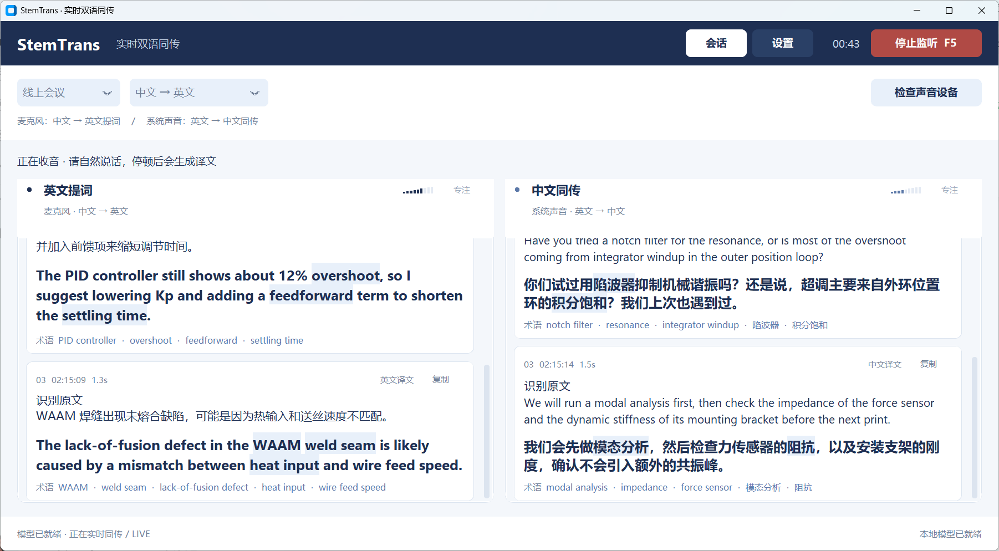
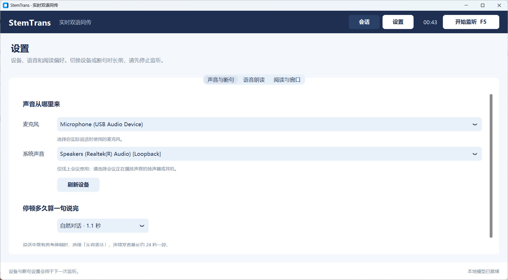

<h1 align="center">StemTrans-Portable</h1>

<p align="center">
  <b>面向理工科科研交流的 Windows 11 实时双语同传 & 英文提词器</b><br>
  <sub>100% 本地 · 纯 CPU · 无云端 · WASAPI 共享采集 · 防串音互斥锁 · 机电工程术语增强</sub>
</p>

<p align="center">
  
  
  
  
  
</p>



<p align="center">
  <sub>
    ▲ <b>真实窗口抓拍，不是效果图。</b> 由 <code>capture_readme_screenshots.py</code> 启动生产界面
    <code>ui/main_window.py</code>，填入 6 条机电工程双语示例文本（用于排版展示，不代表实测识别结果）后，经 DPI 感知 + DWM 可见边框 +
    <code>PIL.ImageGrab</code> 截取真实屏幕像素生成（1802×994，125% 缩放，Per-Monitor V2）。
    重新生成：<code>python capture_readme_screenshots.py</code>
  </sub>
</p>

---

## 目录

- [为什么做这个项目](#为什么做这个项目)
- [核心特性](#核心特性)
- [界面：极简深蓝设计系统](#界面极简深蓝设计系统)
- [两种场景，一套界面](#两种场景一套界面)
- [防串音：软件 TTS 互斥锁](#防串音软件-tts-互斥锁)
- [系统架构](#系统架构)
- [目录结构](#目录结构)
- [快速开始](#快速开始)
- [中国大陆 / 海外双源指南](#中国大陆--海外双源指南)
- [模型清单](#模型清单)
- [配置说明](#配置说明)
- [术语库](#术语库)
- [性能与延迟（参考）](#性能与延迟参考)
- [隐私与“纯绿色”的边界](#隐私与纯绿色的边界)
- [故障排除](#故障排除)
- [开发与自检](#开发与自检)
- [Roadmap](#roadmap)
- [许可证](#许可证)
- [English](#english)

---

## 为什么做这个项目

线上组会、国际会议、外教课程和线下学术接待，对机械电子工程（Mechatronics）方向的学生有一个共同的痛点：

1. **专业术语一错，整句就废。** 通用翻译把 `WAAM` 译成“哇姆”、把 `impedance` 译成“阻碍”、把 `PID overshoot` 译成“皮德过度射击”。通用模型不认识你的领域。
2. **云端同传不能用。** 实验室数据、未发表的焊缝缺陷图像、导师的基金想法，不应该上传到任何服务器；会议室网络也经常不稳。
3. **没有 GPU。** 笔记本只有集成显卡，装不动 Whisper large + 7B 模型，也不想为了开个会风扇狂转。
4. **传统方案会“自己听自己”。** 一旦开启语音朗读，麦克风或系统内录把 TTS 的声音又录进去，翻译结果指数级自我繁殖，十秒内彻底失控。
5. **安装门槛高。** `pip install llama-cpp-python` 在 Windows 上触发 MSVC 编译；HuggingFace 在国内直连超时；Conda 环境一不小心装进 base。

StemTrans-Portable 是这五个问题的工程化答案：**纯 CPU、纯本地、双源下载、免编译安装、共享模式采集、TTS 软件互斥**，并且把界面做成了一张可以放在副屏上一直盯着看的极简深蓝“提词板”。

---

## 核心特性

| 能力 | 实现 | 说明 |
| :--- | :--- | :--- |
| 语音活动检测 | **Silero VAD v5.1.2 (ONNX Runtime)** | 直接跑 ONNX 图，不装 PyTorch；512 采样/32 ms 帧，自动切句 |
| 语音识别 | **Faster-Whisper base/small, int8** | `device="cpu"`, `compute_type="int8"`，CTranslate2 后端 |
| 翻译 | **Qwen2.5-1.5B-Instruct Q4_K_M (GGUF)** | `llama-cpp-python`，mmap，纯 CPU，4 线程 |
| 术语增强 | **91 条机电/嵌入式/控制/增材词库** | 翻译阶段注入相关术语；ASR 术语提示可选，默认关闭 |
| 音频采集 | **PyAudioWPatch / WASAPI Shared** | 麦克风 + 系统回环，不独占、不抢设备 |
| 防串音 | **`TTSGate` 全局互斥 + 350 ms 冷却** | 播报期间持续排空采集队列，零积压 |
| 语音输出 | **pyttsx3 / SAPI5（可选，默认关闭）** | 完全离线，无网络 TTS |
| 界面 | **CustomTkinter，极简深蓝** | 强制 light；雾白 + 瓷白 + 深海蓝 + 冰蓝，单一强调色 |
| 便携 | **环境变量在 import 前重定向** | 模型/缓存/日志全部落在软件目录 |
| 退出 | **`WM_DELETE_WINDOW` → 停止线程 → `os._exit`** | 实测 0.28 s 退出（双通道运行中），无托盘、无僵尸进程 |
| 打包 | **PyInstaller onedir + `--contents-directory .`** | 生成可拷进 U 盘的独立文件夹 |

---

## 界面：极简深蓝设计系统

保留雾白、瓷白、深蓝和冰蓝配色。会话页只展示收音控制、原文和译文；声音设备、朗读和窗口偏好放在独立设置页，避免挤占阅读空间。

| 角色 | 色值 | 用途 |
| :--- | :--- | :--- |
| 雾白 | `#F4F7FB` | 主画布背景 |
| 瓷白 | `#FFFFFF` | 通道面板、字幕卡片 |
| 深海蓝 | `#1E2F52` | 顶栏、正文、主按钮 |
| 靛蓝 | `#3E5C8F` | 次要强调、术语文字 |
| 冰蓝 | `#E8F0FA` | hover、术语命中底色 |
| 线灰 | `#DCE5F0` | 1 px 边框与分割线 |
| 雾灰 | `#6F7E95` | 原文、时间戳、辅助信息 |
| 点红 | `#B04A45` | 仅录音指示与「停止」 |

使用方式：

1. 在会话页选择「单麦对话」或「线上会议」。单麦可选「中文 → 英文」「英文 → 中文」「中英自动互译」，默认明确按中文识别。
2. 点击「检查声音设备」，在设置中选对麦克风；线上会议还要选与会议扬声器一致的系统声音设备。
3. 点击「开始监听」或按 F5，自然说完一句话。默认等待约 1.1 秒停顿，再生成原文和译文。
4. 翻译生成前先显示识别原文；结果卡片明确区分原文和译文，避免把译文误认为识别内容。
5. 「停止监听」会保留最后一句，已收到的音频继续处理；处理完即可再次开始，已有卡片保留。

- 单向翻译显示一个宽阅读区；双向模式显示双栏，可点击「专注」放大一侧。
- 中文译文 25 px、英文译文 26 px，原文 17 px；设置中还可选择「大字」「特大」。
- 设置分为「声音与断句」「语音朗读」「阅读与窗口」。开始 / 停止按钮始终可见。
- 断句提供 0.7 / 1.1 / 1.6 秒三档。思考停顿较多时选「从容表达」。
- 显示正在收音、正在识别、正在翻译、积压段数和朗读暂停收音状态。
- F5 开始 / 停止，Ctrl + Shift + C 复制最新译文，Esc 返回会话。



两张图均由生产界面真实抓拍，内容为排版示例。字体使用 Microsoft YaHei UI / Segoe UI，并保留系统字体回退。

---

## 两种场景，一套界面

### 模式 A：线上会议双通道

```
麦克风  ──► 中文 ASR ──► ZH→EN ──► 01 提词卡【中文原文 + 加粗英文】
系统回环 ──► 英文 ASR ──► EN→ZH ──► 02 同传卡【英文原文 + 中文译文】
```

- **我方通道**监听麦克风，识别中文，译成学术英文，供你直接照读。
- **对方通道**通过 WASAPI Loopback 监听扬声器/耳机混音，识别英文，译成中文。
- 两个通道互不干扰；Zoom / Teams / 腾讯会议继续正常使用扬声器和麦克风。

### 模式 B：单麦对话（默认）

只采集麦克风，不采集系统声音。默认「中文 → 英文」：中文识别原文和英文译文显示在同一阅读区。需要反方向时选择「英文 → 中文」；两人交替说不同语言时，可选择「中英自动互译」。

自动模式会结合 Whisper 语种判断与文本字符分布决定方向；短句、混合语言和噪声仍可能判断错误。已知说话语言时，优先明确指定方向。

---

## 防串音：软件 TTS 互斥锁

自动朗读每次启动都关闭，需要在「设置 → 语音朗读」中主动开启，仅对本次运行生效。

**整个朗读期间，以及结束后 350 毫秒，麦克风和系统声音都会暂停采集。此时说的话不会被记录。** 界面会显示“正在朗读，收音已暂停”；需要连续讲话时，请保持自动朗读关闭。这是软件采集门控，并非声学回声消除或可同时听说的全双工方案。

`TTSGate.begin()` 在播放前关闭采集，采集线程持续排空回调队列。SAPI 在自己的工作线程中泵送事件；关闭朗读开关或停止监听会请求该线程中断播放，结束后保留冷却时间，避免积压的声音再次被识别。

---

## 系统架构

```
┌──────────────────────────────── Windows 11 (no GPU, no cloud) ────────────────────────────────┐
│                                                                                              │
│  Mic ─────┐                                                                                  │
│           ├─ WASAPI Shared ─► 48k/44.1k→16k ─► Silero VAD ─► UtteranceSegmenter ─┐           │
│  Loopback ┘   (PyAudioWPatch)   FIR + linear      ONNX Runtime     1.1 s hangover │           │
│                                                                                   ▼           │
│  TTSGate ◄── drop + drain ◄──────────────┐                              Faster-Whisper int8   │
│      ▲                                   │                                       │           │
│      │ begin/end                         │                                       ▼           │
│  pyttsx3 SAPI5 ◄── EN text ◄── Qwen2.5-1.5B GGUF (llama.cpp, 4 threads) ◄── ZH / EN text     │
│      │                                            │                                          │
│      └──────────────► CustomTkinter UI ◄──────────┘                                          │
│                        (main thread queue)                                                   │
└──────────────────────────────────────────────────────────────────────────────────────────────┘
```

线程模型：

| 线程 | 职责 | 退出方式 |
| :--- | :--- | :--- |
| Tk main | 只做 UI；所有跨线程消息走 `window.post()` 队列 | `WM_DELETE_WINDOW` |
| `stemtrans-mic` | 麦克风采集 + VAD 分段 | `stop_event` + 关闭 stream |
| `stemtrans-loopback` | 回环采集 + VAD 分段（仅模式 A） | 同上 |
| `stemtrans-inference` | ASR → MT → UI 事件（单线程保序；过载明确报错并停止收音） | `stop_event` |
| `stemtrans-tts` | SAPI5 播报（懒启动） | `stop_event` + `engine.stop()` |
| `stemtrans-preload` | 后台加载模型，不阻塞界面 | 随进程退出 |

> **UI 线程绝不碰模型，模型线程绝不碰 Tk。** 长期会议稳定性仍需在实际会议软件中验证。

---

## 目录结构

```
StemTrans-Portable/
├── assets/
│   ├── .gitkeep
│   ├── ui_live_capture.png          # 默认视图（真实抓拍）
│   └── ui_settings_capture.png      # 独立设置页（真实抓拍）
├── config/
│   ├── settings.json                # 可提交的默认配置（个人偏好放 settings.local.json）
│   └── glossary.json                # 91 条机电工程中英术语
├── core/
│   ├── __init__.py
│   ├── audio_capture.py             # WASAPI + VAD + TTS 防回环
│   ├── inference_engine.py          # Faster-Whisper + Qwen2.5 + 词库注入
│   └── tts_worker.py                # SAPI5 线程 + TTSGate
├── models/                          # 全部本地模型与缓存（Git 忽略）
│   ├── .gitkeep
│   ├── silero_vad.onnx
│   ├── whisper-base/
│   └── qwen2.5-1.5b-instruct-q4_k_m.gguf
├── ui/
│   ├── __init__.py
│   └── main_window.py               # 极简深蓝界面
├── logs/                            # 运行日志（Git 忽略）
├── capture_readme_screenshots.py    # 真实窗口抓拍
├── download_models.py               # 国内 / 海外双源下载
├── setup_conda_env.bat              # 一键环境（清华源 + 免编译 wheel）
├── run_app.bat                      # 日常双击启动
├── build_portable.bat               # PyInstaller 绿色文件夹
├── main.py                          # 环境隔离 + 主入口
├── environment.yml
├── requirements.txt
├── .gitignore
└── README.md
```

---

## 快速开始

### 0. 前置

- Windows 10 2004+ / Windows 11（WASAPI Loopback 需要 Win10 以上）
- Anaconda 或 Miniconda（已加入 PATH，或装在默认目录）
- 约 3 GB 磁盘（模型 1.3 GB + 环境约 1.2 GB）
- 4 核 CPU 起步；8 核更从容
- **不需要 GPU，不需要 CUDA，不需要 Visual Studio**

### 1. 克隆

```powershell
git clone https://github.com/lijiawei255/StemTrans-Portable.git
cd StemTrans-Portable
```

### 2. 一键安装（推荐）

```bat
setup_conda_env.bat
```

脚本会：

1. 找到 Anaconda，创建**独立的** `stemtrans` 环境（Python 3.10），**绝不碰 base**；
2. 询问使用 **清华 Tuna 镜像** 还是官方源；
3. 先单独安装 `llama-cpp-python` 的**官方预编译 CPU wheel**，再装其余依赖；
4. 询问是否下载 1.3 GB 模型（支持断点续传）；
5. 最后运行 `capture_readme_screenshots.py`，在你本机重新拍一张真实界面图。

非交互 / CI：

```bat
setup_conda_env.bat /yes            :: 全自动，中国源
setup_conda_env.bat /check          :: 只检查，不安装
setup_conda_env.bat /skip-llm       :: 不装 llama.cpp，退回术语对照
setup_conda_env.bat /no-capture     :: 跳过截图
```

### 3. 手动安装（等价流程）

```powershell
conda env create -f environment.yml
conda activate stemtrans

# 关键：只允许二进制 wheel，禁止源码编译
python -m pip install "llama-cpp-python>=0.3.8,<0.4" `
  --only-binary=:all: `
  --extra-index-url https://abetlen.github.io/llama-cpp-python/whl/cpu

python -m pip install -r requirements.txt
python download_models.py --source china
```

### 4. 启动

```bat
run_app.bat
```

或者：

```powershell
conda activate stemtrans
python main.py
```

首次启动会加载 Whisper（约 1–2 s）和 Qwen（约 2–5 s，取决于磁盘）。状态栏会依次显示 `LOADING ASR → LOADING LLM → READY`。

### 5. 打包成绿色文件夹

```bat
build_portable.bat
```

输出 `dist\StemTrans-Portable\`：

```
StemTrans-Portable.exe
config\  assets\  models\  README.md  LICENSE
```

整个文件夹可以拷到 U 盘或另一台无 Python 的 Windows 11 机器上直接运行。模型是否复制进包内会在脚本里询问（+1.3 GB）。

---

## 中国大陆 / 海外双源指南

### 一键选择

| 场景 | 命令 | Pip | Conda | 模型 |
| :--- | :--- | :--- | :--- | :--- |
| 中国大陆 | `--source china` | 清华 Tuna | 清华 conda-forge | HF-Mirror / ModelScope / jsDelivr |
| 海外 | `--source global` | PyPI | conda-forge | HuggingFace / GitHub |

### 模型下载的源顺序

`download_models.py` 不是“一个 URL 硬编码”，而是**逐源回退**：

| 组件 | 中国源顺序 | 海外源顺序 |
| :--- | :--- | :--- |
| Silero VAD | jsDelivr（固定 tag `v5.1.2`）→ GitHub raw | GitHub raw → jsDelivr |
| Whisper | HF-Mirror | HuggingFace |
| Qwen2.5 GGUF | ModelScope → HF-Mirror | HuggingFace |

> VAD 模型**锁定在 `v5.1.2`**：它的 ONNX 图要求 512 采样（32 ms）的帧。上游 `master` 已切换到 256 采样图，混用会导致“永远检测不到语音”。下载器用 SHA-256 校验，运行时也会检查模型哈希并给出明确提示。

每个文件先写 `<name>.part`，用 HTTP `Range` 续传；服务器不支持 Range 时自动从头重下；HTML 登录页会被识别为错误而不是保存成模型。

```powershell
# 断点续传：直接重复同一条命令
python download_models.py --source china --all

# 只下翻译模型
python download_models.py --only llm --source global

# 检查镜像连通性（HEAD，不下载）
python download_models.py --check-urls --source china

# 校验本地文件大小 / GGUF 与 ONNX 魔数
python download_models.py --verify
```

### 环境变量

`main.py` 在**导入任何 AI 库之前**完成重定向：

```python
os.environ["HF_HOME"]        = os.path.abspath("./models/hf_cache")
os.environ["HF_HUB_CACHE"]   = os.path.abspath("./models/hf_cache/hub")
os.environ["TORCH_HOME"]     = os.path.abspath("./models/torch_cache")
os.environ["OMP_NUM_THREADS"] = "4"
# 国内默认：
os.environ["HF_ENDPOINT"]    = "https://hf-mirror.com"
```

`download_models.py` 会根据 `--source` 设置 `HF_ENDPOINT`，并把选择写入 `config/settings.local.json`，下次启动保持一致。

### 关于 PyPI 的 `--extra-index-url`

```text
-i https://pypi.tuna.tsinghua.edu.cn/simple
--extra-index-url https://abetlen.github.io/llama-cpp-python/whl/cpu
```

`-i` 把**主索引**换成清华；`--extra-index-url` 只额外提供 llama.cpp 的 CPU wheel。两者不冲突。`llama-cpp-python` 的 wheel 不在清华镜像里，所以这一行不能省。

---

## 模型清单

| 组件 | 仓库 / 文件 | 大小 | 许可 |
| :--- | :--- | ---: | :--- |
| VAD | `snakers4/silero-vad` `v5.1.2` → `silero_vad.onnx` | 2.3 MB | MIT |
| ASR base | `Systran/faster-whisper-base` | 147.8 MB | MIT |
| ASR small（可选） | `Systran/faster-whisper-small` | ~486 MB | MIT |
| MT | `Qwen/Qwen2.5-1.5B-Instruct-GGUF` → `q4_k_m` | 1.12 GB | Apache-2.0 |

Whisper 与 Qwen 的许可证允许本地使用与再分发；如果你把模型打包进发行物，请保留各自的 LICENSE。

---

## 配置说明

`config/settings.json` 保存可提交的默认配置；`config/settings.local.json` 保存本机设备和个人偏好，并覆盖默认值。后者被 Git 忽略，也不进入打包产物。常用字段：

| 字段 | 默认 | 说明 |
| :--- | :--- | :--- |
| `network.source` | `china` | `china` / `global` |
| `ui.mode` | `offline` | `online` 双通道 / `offline` 单麦 |
| `ui.opacity` | `0.97` | 0.5–1.0，滑块的初始值 |
| `ui.always_on_top` | `true` | 置顶 |
| `audio.mic_device` | `""` | 设备**名称**（不是索引，重启后仍有效） |
| `audio.loopback_device` | `""` | 同上 |
| `audio.vad.threshold` | `0.5` | Silero 语音概率阈值 |
| `audio.vad.min_silence_ms` | `1100` | 断句静音时长；界面可选 700 / 1100 / 1600 ms |
| `audio.vad.max_utterance_s` | `24.0` | 连续发言安全上限；边界保留 320 ms 上下文，极长句仍会分段 |
| `asr.model_dir` | `models/whisper-base` | 也可换 `whisper-small` |
| `asr.language_single` | `zh` | 单麦语种：`zh` / `en` / `auto` |
| `asr.use_glossary_prompt` | `false` | 默认不向 ASR 注入大量术语，降低弱语音受提示词干扰的风险 |
| `asr.compute_type` | `int8` | CPU 推荐；`int8_float32` 更准更慢 |
| `llm.n_threads` | `4` | 与 `OMP_NUM_THREADS` 一致 |
| `llm.max_tokens` | `220` | 上限，实际会按句长收紧 |
| `tts.enabled` | `false` | 启动时强制关闭；本次运行可通过界面或 `--tts` 开启 |
| `tts.cooldown_ms` | `350` | TTS 结束后的静音冷却 |
| `pipeline.queue_size` | `24` | 有界队列；满时保留已接收语音，明确提示本段未保存并停止收音 |

设备、透明度、场景和断句偏好会写入 `config/settings.local.json`（600 ms 防抖）；字号在退出时保存。旧版配置首次加载会迁移到 version 2，保留设备选择并更新断句、识别与队列参数。

---

## 术语库

`config/glossary.json` 目前有 **91 条**（其中 30 条带缩写），覆盖：

- 嵌入式：MCU / STM32 / FPGA / PCB / RTOS / ISR / DMA / SPI / I2C / UART / CAN / PWM / ADC / DAC
- 控制：PID / 超调 / 调节时间 / 稳态误差 / 前馈 / 传递函数 / Bode / 根轨迹 / 相位裕度 / 阻尼比 / 陷波器 / 卡尔曼 / 状态观测器 / 积分饱和
- 传感：应变片 / 惠斯通电桥 / 热电偶 / 压电 / 加速度计 / 激光位移 / 信号隔离 / CMRR / 电气隔离 / 光耦 / 阻抗 / 迟滞 / 标定
- 制造：WAAM / 焊缝 / 未熔合 / 热输入 / 送丝速度 / 机器视觉 / 缺陷检测 / 模态分析 / FEA
- 学术：鲁棒性 / 实验验证 / 对照组 / 可重复性 / 数字孪生 / IIoT / PLC / 上位机 / DAQ / SNR

### 两个应用阶段

1. **ASR（可选）**：`asr.use_glossary_prompt=true` 时注入最多 780 字符的术语提示。默认关闭，优先保留说话原意；实际识别仍可能出现错字。
2. **LLM**：`Glossary.relevant_pairs(text)` 先挑出当前句真正出现的术语，再补足核心词，最多 26 对，注入 Qwen 的 System Prompt。1.5B 模型上下文有限，不能把 91 条全塞进去。

### 新增一条

```json
{"zh": "柔顺控制", "en": "compliance control", "abbr": ""}
```

重启应用即可生效。`abbr` 会同时作为高亮和匹配的别名（例如 `PID`）。

---

## 性能与延迟（参考）

2026-10-21 在本机 `stemtrans` 环境，用 SAPI 生成的中英文测试语音验证本地 VAD → Whisper base int8 → Qwen2.5 翻译：

| 样本 | 切出的音频 | ASR + 翻译耗时 | 结果 |
| :--- | :--- | :--- | :--- |
| 中文，含 700 ms 思考停顿 | 约 10.6 秒 | 约 2.6 秒 | 保留为一段，首尾内容均识别 |
| 英文完整句 | 约 7.7 秒 | 约 2.3 秒 | 原文完整识别并生成中文译文 |
| 静音 / 低强度随机噪声 | 各 2 秒 | — | 未生成识别文字 |
| 真实 WASAPI 回环播放英文样本 | — | — | 完整识别，播放停止后自动提交尾句 |

这些是合成语音的本机回归结果，不代表自然人声、口音、嘈杂环境或长期会议的准确率。实际响应还包含断句等待（默认 1.1 秒）与排队时间。Whisper base 和 1.5B 翻译模型仍可能误识别、漏译或误译，请结合卡片中的原文核对。

需要更快响应可选择「紧凑发言」；需要容纳思考停顿可选择「从容表达」。连续发言超过约 24 秒仍会拆段，并保留少量音频重叠。

---

## 隐私与“纯绿色”的边界

**运行期不联网。** 模型全部本地，`faster-whisper` 以 `local_files_only=True` 加载，`llama.cpp` 读本地 GGUF，TTS 走 Windows SAPI5。没有遥测、没有账号、没有 API Key。

**不写注册表、不开机自启、无托盘常驻。** 关窗即走，`os._exit(0)` 兜底。

**所有运行时写入都在软件目录：**

```
models\hf_cache\      models\torch_cache\      models\xdg_cache\
logs\app.log          config\settings.local.json
```

**诚实的边界：**

- `setup_conda_env.bat` 会用 Anaconda 在 `envs\stemtrans` 创建环境，这个目录在 Anaconda 安装位置，不在项目文件夹里。这是 Conda 的工作方式，不是应用写系统目录。
- 想要“拷贝即用、完全独立”，请用 `build_portable.bat` 生成 `dist\StemTrans-Portable\`，那个文件夹不含 Conda 依赖。
- PyInstaller 生成的 exe 未签名，SmartScreen 可能提示“未知发布者”；这是所有未签名开源工具的共性，可自行校验源码后运行。

---

## 故障排除

<details>
<summary><b>1. pip 安装 llama-cpp-python 报 MSVC / CMAKE 错误</b></summary>

说明 pip 退回了源码包。强制只装二进制：

```powershell
python -m pip install "llama-cpp-python>=0.3.8,<0.4" `
  --only-binary=:all: `
  --extra-index-url https://abetlen.github.io/llama-cpp-python/whl/cpu
```

仍然失败：确认 Python 是 3.10/3.11/3.12（`python -V`），并确认能打开 <https://abetlen.github.io/llama-cpp-python/whl/cpu>。实在不行用 `setup_conda_env.bat /skip-llm`，翻译退回术语对照模式。
</details>

<details>
<summary><b>2. `ImportError: DLL load failed`（llama_cpp / onnxruntime）</b></summary>

安装 **Microsoft Visual C++ 2015–2022 Redistributable (x64)**，然后重启终端。wheel 里的 `llama.dll` / `onnxruntime.dll` 依赖它。
</details>

<details>
<summary><b>3. 找不到 WASAPI Loopback 设备</b></summary>

- 确认系统是 Windows 10 2004+ / Windows 11；
- 在“声音设置”里确认有正在使用的播放设备；
- 更新 Realtek / Intel SST / USB 声卡驱动；
- 某些虚拟声卡（VB-Cable 等）不提供 loopback，改用物理输出设备；
- 实在没有回环时，应用会明确提示启动失败；可切换到「单麦对话」继续使用麦克风。
</details>

<details>
<summary><b>4. 开启 TTS 后仍然重复翻译</b></summary>

默认就不该开 TTS。若必须开：

- 用耳机，不要用外放；
- 确认 `tts.cooldown_ms` 不小于 `350`；
- 确认没有其他程序在把 TTS 的声音路由回麦克风（例如“立体声混音”被设为默认输入）；
- 观察“正在朗读，收音已暂停”提示，等收音恢复后再讲话；关闭开关可中断当前朗读。
</details>

<details>
<summary><b>5. 模型下载 401 / 403 / 超时</b></summary>

- 国内：`python download_models.py --source china --all`（HF-Mirror + ModelScope + jsDelivr）；
- 海外：`--source global`；
- 公司/校园网拦截 `huggingface.co` 时，用手机热点验证；
- 已下载一半：重复同一条命令，`.part` 会续传；
- 校验：`python download_models.py --verify`。
</details>

<details>
<summary><b>6. 截图脚本失败（黑图 / 裁切）</b></summary>

`capture_readme_screenshots.py` 需要**已解锁的交互式桌面**：

- 不要在远程桌面最小化、锁屏或纯 SSH 会话里运行；
- 运行后 1 秒内不要遮挡窗口；
- 多显示器/高 DPI 已由 Per-Monitor V2 + DWM 边框处理；
- 无 GUI 的 CI 机器无法截图，这是预期行为，不影响应用运行。
</details>

<details>
<summary><b>7. 中文输出乱码</b></summary>

`setup_conda_env.bat` 和 `run_app.bat` 已设置 `chcp 65001`；Python 侧设置 `PYTHONUTF8=1`。如果在旧版 PowerShell 5.1 里手动运行，先执行：

```powershell
$env:PYTHONUTF8=1; $env:PYTHONIOENCODING="utf-8"
```
</details>

<details>
<summary><b>8. 关闭窗口后还有 python.exe</b></summary>

正常路径下不会。若出现，说明某个驱动在 `stream.close()` 里卡死：

- 查看 `logs\app.log` 最后一行是否为 `clean exit in ...`；
- 用任务管理器结束残留进程；
- 更新声卡驱动；
- `main.py` 已在 `shutdown()` 末尾调用 `os._exit(0)`，理论上任何非 daemon 线程都无法阻止退出。
</details>

---

## 开发与自检

```powershell
# 依赖 / 模型 / 设备一次看清
python main.py --self-test

# 不依赖硬件与模型的回归测试
python -m unittest discover -s tests -v

# GUI 回归测试（需交互式桌面）
$env:STEMTRANS_UI_TEST="1"
python -m unittest discover -s tests -v

# 只列音频端点
python main.py --list-devices

# 音频链路自测：录 4 秒，打印 VAD 切出的句子
python -m core.audio_capture --seconds 4

# 回环链路自测（播放一段英文视频后运行）
python -m core.audio_capture --seconds 6 --loopback

# 只看术语注入效果，不加载模型
python -m core.inference_engine --text "我们用 STM32 通过 SPI 读取 ADC，PID 超调 12%。"

# 重新抓拍 README 截图
python capture_readme_screenshots.py --check     # 只排版，不截图
python capture_readme_screenshots.py --keep-open # 手动看界面

# 打包
build_portable.bat
```

语音检测必须保留 Silero v5.1.2 的 **512 样本 hop + 64 样本前文**（ONNX 输入共 576 样本）。参考 [官方 v5.1.2 包装器](https://github.com/snakers4/silero-vad/blob/v5.1.2/src/silero_vad/utils_vad.py)。不要将 hop 大小误当作完整模型输入。

代码约定：

- 任何 AI 库的 import 都必须**在 `main.py` 的环境变量重定向之后**，或延迟到函数内部；
- `ui/main_window.py` 不允许 import `numpy` / `faster_whisper` / `llama_cpp`；
- 新增跨线程 UI 更新必须走 `window.post({...})`，禁止在音频/推理线程直接调用 Tk；
- 新增术语只改 `config/glossary.json`，不改代码。

---

## Roadmap

- [ ] Token 级流式翻译预览（当前是整句上屏）
- [x] 断句时长三档选择
- [ ] 高级 VAD 阈值调参
- [ ] 会话导出（Markdown / SRT / JSONL）
- [ ] 全局快捷键（开始/停止/复制），不依赖窗口焦点
- [ ] 双通道音频电平历史曲线
- [ ] 可选 `whisper-small` 一键切换向导
- [ ] 术语库导入/导出（CSV）

---

## 许可证

MIT License © 2026 **JIAWEI LI**. 见 [LICENSE](./LICENSE)。

模型与第三方组件遵循各自许可证：Silero VAD (MIT)、Faster-Whisper (MIT)、CTranslate2 (MIT)、Qwen2.5 (Apache-2.0)、llama.cpp (MIT)、CustomTkinter (MIT)。

如果这个项目帮你顺利完成了一次组会或国际会议，欢迎在 GitHub 上点一个 Star。

---

## English

**StemTrans-Portable** is a 100% local, CPU-only, real-time bilingual interpreter and English teleprompter for Windows 11, built for mechatronics / embedded / control engineering conversations.

### Why it is different

- **Domain glossary.** 91 mechatronics terms inform the translation prompt. Whisper terminology prompting is optional and off by default to reduce prompt echo on weak or short speech.
- **Non-intrusive audio.** PyAudioWPatch captures the microphone and the WASAPI loopback in **shared mode**. Zoom/Teams keep working; no device is ever opened exclusively.
- **Speech output with capture gating.** A global `TTSGate` mutes and *drains* every capture channel while SAPI5 is speaking, plus a 350 ms cooldown. The PortAudio callback keeps filling a bounded queue; the capture thread empties it every 20 ms, to prevent playback from being fed back to ASR. Automatic speech is off at every launch; speech spoken by the user during playback is not recorded.
- **Truly portable.** `HF_HOME`, `HF_HUB_CACHE`, `TORCH_HOME`, `XDG_CACHE_HOME` and thread limits are redirected to `./models` before any AI import. Runtime writes stay inside the app folder. Closing the window stops every thread and calls `os._exit(0)` (measured ~0.28 s with both channels running).
- **Zero-compile install.** `llama-cpp-python` comes from the official pre-built CPU wheel index, so no MSVC/CMake is required.
- **Dual network sources.** China: Tsinghua PyPI/conda mirrors, HF-Mirror, ModelScope, jsDelivr. Global: PyPI, HuggingFace, GitHub. Downloads resume from `.part` files with HTTP Range requests.
- **Two scenes.** Online dual-channel (mic ZH→EN + loopback EN→ZH) and single-mic with explicit Chinese→English, English→Chinese, or optional automatic routing.

### Quick start

```bat
git clone https://github.com/lijiawei255/StemTrans-Portable.git
cd StemTrans-Portable
setup_conda_env.bat        :: creates conda env "stemtrans", installs wheels, downloads models
run_app.bat                :: daily launcher
```

Manual:

```powershell
conda env create -f environment.yml
conda activate stemtrans
python -m pip install "llama-cpp-python>=0.3.8,<0.4" --only-binary=:all: `
  --extra-index-url https://abetlen.github.io/llama-cpp-python/whl/cpu
python -m pip install -r requirements.txt
python download_models.py --source global
python main.py
```

### Screenshot

The image at the top is a **real screen capture** of the production window, with illustrative transcript text, produced by `capture_readme_screenshots.py` (Per-Monitor V2 DPI awareness, DWM extended frame bounds, `PIL.ImageGrab`). Regenerate it on your own machine:

```powershell
python capture_readme_screenshots.py
```

### Architecture

```
Mic / Loopback -> WASAPI shared -> 16 kHz -> Silero VAD (ONNX) -> segment
    -> Faster-Whisper int8 -> Qwen2.5-1.5B Q4_K_M (llama.cpp) -> CustomTkinter UI
                              ^
                      TTSGate mutex (SAPI5 + 350 ms)
```

### License

MIT © 2026 JIAWEI LI. Third-party models keep their own licenses (Silero MIT, Faster-Whisper MIT, Qwen2.5 Apache-2.0).

---

<p align="center">
  <sub>Built for the lab, the group meeting, and the conference call that starts in five minutes.</sub>
</p>
